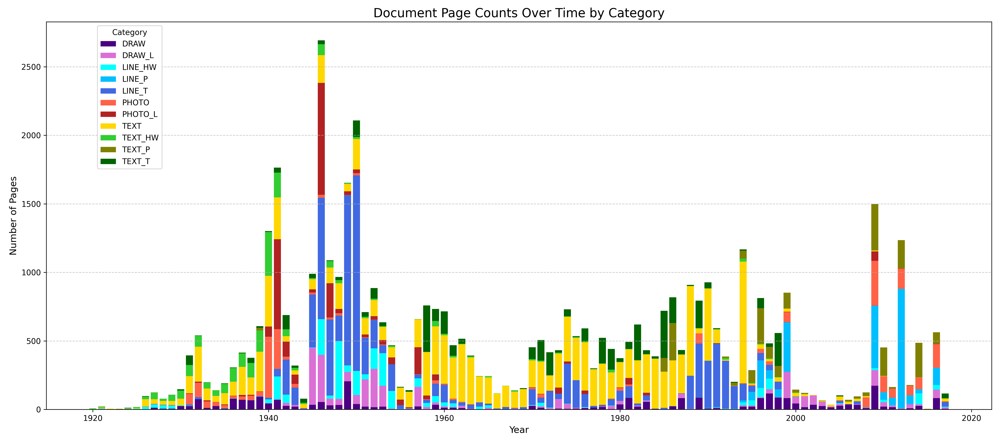
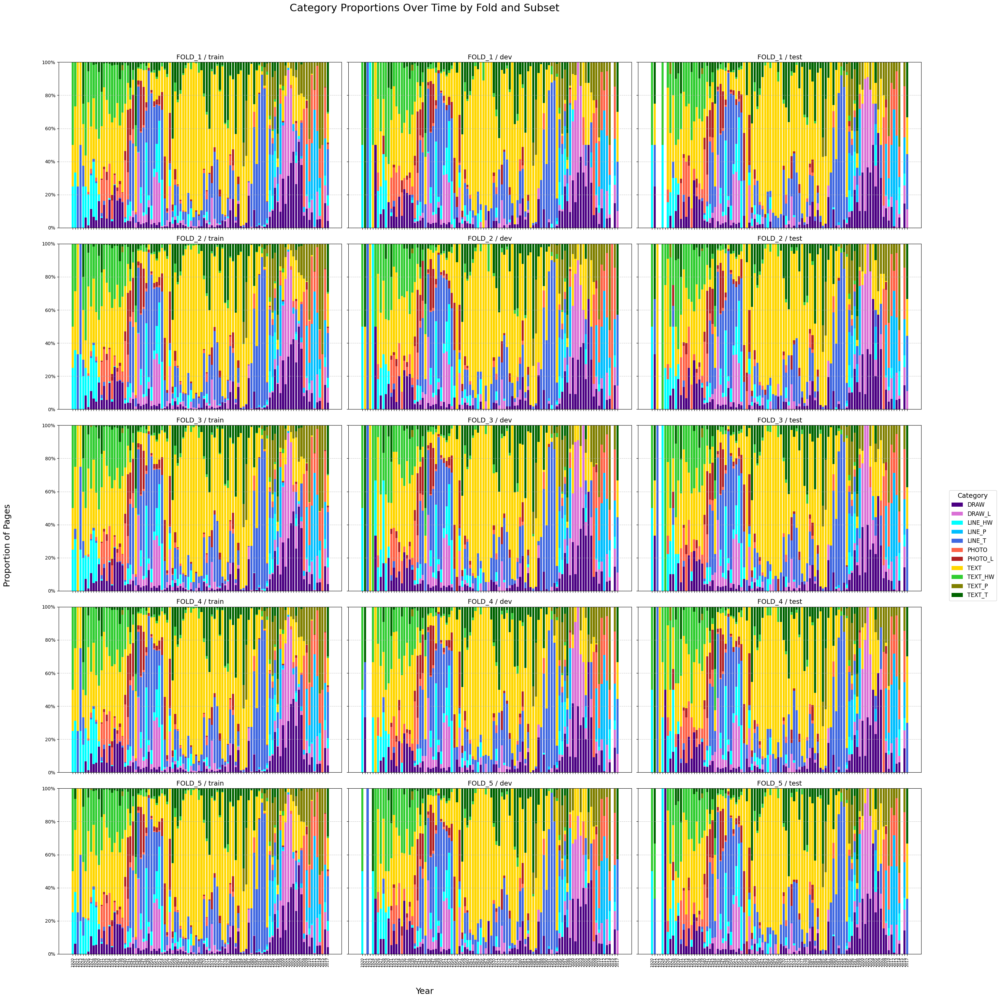

# The data

For anyone who wants to know what the models learned from: the annotated page dataset, its categories over time, how
it is split into training, development and test pages, and how the data of each model generation differ. The results
measured on it are in [results.md](results.md).

On this page:
[The dataset](#the-dataset) ·
[How the dataset is split](#how-the-dataset-is-split) ·
[Training and test sets by generation](#training-and-test-sets-by-generation) ·
[Categories in the data](#categories-in-the-data)

## The dataset

The dataset is published under CC BY-NC 4.0 and consists of **48,499** PNG images of pages from **37,328** archival
documents, spanning 1920–2020: archaeological reports and related material from Czech archives. The page images and
their annotation are in the [LINDAT record](http://hdl.handle.net/20.500.12800/1-6184); the
[small_data_samples](../../small_data_samples) folder holds a few example pages per category, from outside the
training data. The research behind it is described in the preprint
[Page image classification for content-specific data processing](https://arxiv.org/abs/2507.21114) (arXiv
2507.21114): from raw data exploration and the construction of the dataset, through a benchmark of several image
classification approaches (Random Forest, EfficientNetV2, RegNetY, DiT, ViT and CLIP), to the system's architecture
and its results on historical collections from Prague and Brno.

The annotation was done by hand beforehand and took time; the [categories](../reference/categories.md) were formed
from different sources of archival documents of 1920–2020. The content and the language of the pages do not matter at
the model's resolution, but all of them come from **archaeological reports**, which may affect what the models take
for a drawing: pottery fragments, arrowheads and stones, drawn by hand and later illustrated with digital tools, are
common among the `DRAW` pages (examples in [small_data_samples/DRAW](../../small_data_samples/DRAW)).

The `vX.4` models were trained on the subset whose licence is CC BY-NC 4.0: 318 pages were removed for licensing
reasons ([decisions/history.md](../decisions/history.md#2026-06-to-08-retraining-on-the-licensed-dataset-15)).

## How the dataset is split

The dataset is not split by a simple random shuffle: the data hold structured, clustered runs of page types within
many categories, and a random shuffle would likely give subsets with poor representative variability.

Instead, a deterministic, periodic sampling with a randomised offset is used. To make the training set as large as
possible, the development and test subsets are selected first, and the training subset is all the remaining pages.
Per category, the development and test sets are selected like this:

1. For a category of size `N`, compute the subset size `k` as a fixed proportion (`test_ratio`, 10 %) of `N`.
2. Compute a selection step `S ≈ N/k`, the period of the selection.
3. Shift each step at random: the `i`-th of the `k` selections is an integer index in the range
   `[S_i − S/4; S_i + S/4]`.
4. Select every `S`-th element (roughly) of the alphabetically ordered sequence, after the random shift.
5. Limit the selected indices to the range of the category size `N`.

The subsets this produces respect the original ordering and the local clustering of the data, keep the proportion
of each category, and add controlled randomness, so the selection is not strictly periodic. They cover the full
chronological and structural variability of the collection, which makes the evaluation more robust and reliable.

In the last stages the whole procedure was run several times, as cross-validation: each new fold used a random seed
incremented by one for the random shifts (`splitN ↔ foldN ↔ seed 420 + (N−1)`). The annotation published on LINDAT
includes the five splits of the `vX.3` models. The `TEXT` category was capped at `max_categ = 14000` pages, because it
otherwise dominates.

Averaging the weights of all five fold models usually gives a more robust model that scores higher than any of its
components. Sometimes it lowers the accuracy of the most ambiguous categories instead, such as `TEXT` and `TEXT_T`,
whose pages very often look the same: their accuracy can drop below 90 %, with off-diagonal errors above 10 %. Which
happens depends mostly on the base model. The figures behind this observation were measured on a set whose pages the
averaged `a5` models had almost all seen in training
([result/README.md](../../result/README.md#earlier-results-and-their-problems)).

## Training and test sets by generation

Training set of the model, by generation:

| Generation | Training pages |
|------------|---------------:|
| `v2.0`     |          8,950 |
| `v2.1`     |         10,745 |
| `vX.2`     |         14,565 |
| `vX.3`     |         38,625 |
| `vX.4`     |         38,307 |

And the test (evaluation) sets:

- 1,290 pages, taken from the `v2.2` annotations;
- 4,823 pages per fold, for the `vX.3` models;
- 4,791–4,795 pages per fold, for the `vX.4` models: the fold's test partition in the LINDAT record.

The early model versions used 90 % of the data for training and the remaining 10 % as both the development and the
test set, for lack of annotated pages; later versions use 80 % for training and 10 % each for development and test.
The `vX.2` results were scored on 1,583–1,586 pages of the `v2.2` evaluation set ([results.md](results.md#earlier-models)).

## Categories in the data

| Category        | Dataset 0   | Dataset 1    | Dataset 2    | Dataset 3     |
|-----------------|-------------|--------------|--------------|---------------|
| DRAW            | 1090 (9.1%) | 1368 (8.8%)  | 1472 (9.3%)  | 2709 (5.6%)   |
| DRAW_L          | 1091 (9.1%) | 1383 (8.9%)  | 1402 (8.8%)  | 2921 (6.0%)   |
| LINE_HW         | 1055 (8.8%) | 1113 (7.2%)  | 1115 (7.0%)  | 2514 (5.2%)   |
| LINE_P          | 1092 (9.1%) | 1540 (9.9%)  | 1580 (10.0%) | 2439 (5.0%)   |
| LINE_T          | 1098 (9.2%) | 1664 (10.7%) | 1668 (10.5%) | 9883 (20.4%)  |
| PHOTO           | 1081 (9.1%) | 1632 (10.5%) | 1730 (10.9%) | 2691 (5.5%)   |
| PHOTO_L         | 1087 (9.1%) | 1087 (7.0%)  | 1088 (6.9%)  | 2830 (5.8%)   |
| TEXT            | 1091 (9.1%) | 1587 (10.3%) | 1592 (10.0%) | 14227 (29.3%) |
| TEXT_HW         | 1091 (9.1%) | 1092 (7.1%)  | 1092 (6.9%)  | 2008 (4.1%)   |
| TEXT_P          | 1083 (9.1%) | 1540 (9.9%)  | 1633 (10.3%) | 2312 (4.8%)   |
| TEXT_T          | 1081 (9.1%) | 1476 (9.5%)  | 1482 (9.3%)  | 3965 (8.2%)   |
| **Unique PDFs** | 5001        | 5694         | 5729         | 37328         |
| **Total Pages** | 11,940      | 15,482       | 15,854       | 48,499        |

The table shows the categories of the data of successive model versions. The last column (Dataset 3) is the data of
the `vX.3` models, which used 14,000 pages of the `TEXT` category; the other columns count all the pages used, 80 %
for training and 10 % each for development and test.

> [!NOTE]
> The disproportion of the categories, in the training data and in [small_data_samples](../../small_data_samples),
> is **not** intentional: it follows from the nature of the source data.

The timeline of the source documents:

And the categories over time, with the training, development and test subsets of all five cross-validation folds
together: the horizontal axis is the timeline of the source documents, the vertical axis the proportion of pages per
category in each year.

