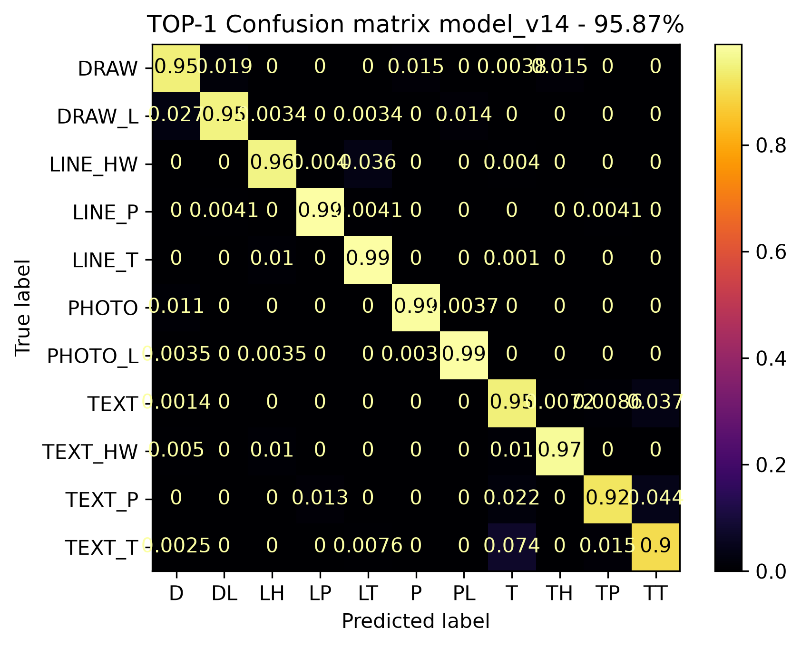
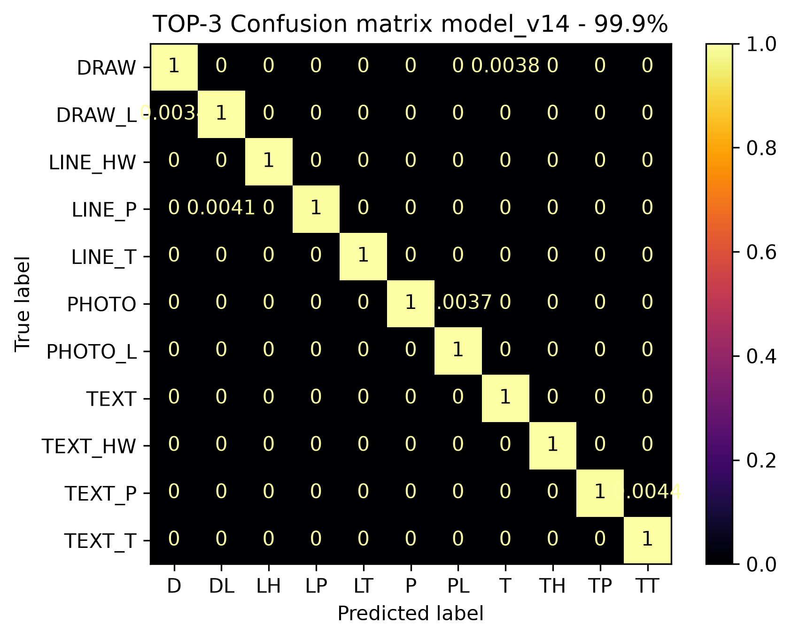

# What was measured

For anyone who has to judge the results: how accurate the published `vX.4` models are on pages they were not trained
on, where they go wrong, and which older figures are not held-out accuracy. The provenance of every figure (code,
model commits, folds, the run's own record) is in [result/README.md](../../result/README.md), which this page
summarises; the data and the split are in [data.md](data.md).

On this page:
[The `vX.4` models on held-out pages](#the-vx4-models-on-held-out-pages) ·
[Where the errors are](#where-the-errors-are) ·
[Confusion matrices](#confusion-matrices) ·
[Reading a confusion matrix](#reading-a-confusion-matrix) ·
[What is not measured](#what-is-not-measured) ·
[Earlier models](#earlier-models)

> [!NOTE]
> The test suite checks that the code does what this documentation says. It does not measure accuracy: the figures
> below come from scoring the models on annotated pages.

## The `vX.4` models on held-out pages

Each of the five published `vX.4` models, those that `--best` and `version=all` use, was scored on the **test
partition of the fold it was trained on**, as published in the
[LINDAT record](http://hdl.handle.net/20.500.12800/1-6184): pages the model never saw in training (2026-10-22,
[atrium-project#15](https://github.com/ufal/atrium-project/issues/15)).

| Base model                               | Revision | Fold | Test pages | Top-1 (%) | Top-3 (%) | Top-1, unseen documents (%) |
|------------------------------------------|----------|------|-----------:|----------:|----------:|----------------------------:|
| `timm/tf_efficientnetv2_m.in21k_ft_in1k` | `v1.4`   | 1    |      4,795 | **95.87** |     99.90 |                       95.60 |
| `timm/regnety_160.swag_ft_in1k`          | `v4.4`   | 1    |      4,795 | **95.81** |     99.79 |                       95.19 |
| `google/vit-base-patch16-384`            | `v3.4`   | 2    |      4,792 | **95.49** |     99.77 |                       94.96 |
| `google/vit-large-patch16-384`           | `v5.4`   | 2    |      4,792 | **95.58** |     99.75 |                       95.29 |
| `google/vit-base-patch16-224`            | `v2.4`   | 5    |      4,791 | **94.64** |     99.81 |                       93.87 |

- **One fold per model.** Each model was trained, and is scored, on one fold of the five; there is no figure across
  folds.
- **The split is by page.** About a quarter of each fold's test pages come from documents that have other pages in
  training; their accuracy is 1–3 points higher. The last column leaves those pages out. No test page is a training
  page.
- **The differences are small.** The 95 % intervals are about ±0.6 points. Two models scored on the same pages do not
  differ significantly (`v1.4` and `v4.4` on fold 1, `v3.4` and `v5.4` on fold 2; exact McNemar tests). `v2.4` is about one point lower,
  but it is the only model on fold 5, so the model and the fold cannot be told apart.
- **The ensemble has no held-out figure.** Its members were trained on different folds, so there is no test set none
  of them saw.

The exact intervals, the figures for pages of seen documents, and the provenance: [result/README.md](../../result/README.md).
The tables behind these figures: [reference/outputs.md](../reference/outputs.md#example-tables-in-this-repository).

## Where the errors are

- `TEXT_T` has the lowest recall, 87–92 %, and is mostly taken for `TEXT`: their pages often look alike.
- Next come `TEXT_P`, `LINE_HW` and `DRAW` (91–96 %); `LINE_HW` is taken for `LINE_T` on 4–9 % of its pages.
- Top-3 contains the true category for 99.75–99.90 % of pages, so a second look at `CLASS-2` and `CLASS-3` catches
  almost every error.

Most errors fall between neighbouring categories. Averaging fold models, or the ensemble, tends to raise overall
accuracy but can lower it on exactly those ambiguous pairs.

## Confusion matrices

Top-1 and Top-3 on each model's fold test pages (2026-10-22):

| Model  | Fold, pages | Top-1 (%) | Top-3 (%) | Top-1 matrix                                                                | Top-3 matrix                                                                |
|--------|-------------|----------:|----------:|-----------------------------------------------------------------------------|-----------------------------------------------------------------------------|
| `v1.4` | 1, 4,795    | **95.87** |     99.90 | [TOP-1](../../result/plots/20261022-0924_4795_model_v14_conf_mat_TOP-1.png) | [TOP-3](../../result/plots/20261022-0937_4795_model_v14_conf_mat_TOP-3.png) |
| `v4.4` | 1, 4,795    | **95.81** |     99.79 | [TOP-1](../../result/plots/20261022-0951_4795_model_v44_conf_mat_TOP-1.png) | [TOP-3](../../result/plots/20261022-1005_4795_model_v44_conf_mat_TOP-3.png) |
| `v3.4` | 2, 4,792    | **95.49** |     99.77 | [TOP-1](../../result/plots/20261022-1021_4792_model_v34_conf_mat_TOP-1.png) | [TOP-3](../../result/plots/20261022-1035_4792_model_v34_conf_mat_TOP-3.png) |
| `v5.4` | 2, 4,792    | **95.58** |     99.75 | [TOP-1](../../result/plots/20261022-1053_4792_model_v54_conf_mat_TOP-1.png) | [TOP-3](../../result/plots/20261022-1110_4792_model_v54_conf_mat_TOP-3.png) |
| `v2.4` | 5, 4,791    | **94.64** |     99.81 | [TOP-1](../../result/plots/20261022-1125_4791_model_v24_conf_mat_TOP-1.png) | [TOP-3](../../result/plots/20261022-1140_4791_model_v24_conf_mat_TOP-3.png) |

The matrices of `v1.4`, the highest top-1 of the five:

## Reading a confusion matrix

A confusion matrix shows on its diagonal the pages whose predicted category matches the gold one, and off the
diagonal the errors between pairs of categories. It tells you **what kind of mistakes to expect** from a model. Every
`--eval` run draws one ([training.md](../training.md#evaluation)).

## What is not measured

- **Born-digital pages.** The models were trained on scanned archival pages; born-digital pages are classified, but
  their labels have not been checked against reviewed answers.
- **Other archives.** The categories and the training pages come from archaeological reports of 1920–2020; pages of
  a very different kind are forced into the nearest category.
- **PDFs rendered by the service.** The service renders PDF pages with pypdfium2, the training pages were made with
  pdftoppm; the difference was measured on labels, not against gold answers
  ([reference/licences.md](../reference/licences.md#the-pdf-renderer)).
- **The ensemble, the YOLO backend and the averaged fold models** have no held-out figure.
- **The sample pages** in [small_data_samples](../../small_data_samples) scored 70–79 % top-1, but they come from
  theses, slides, papers and web pages outside the training data, and their folders were never checked as
  evaluation labels; those tables were removed ([result/README.md](../../result/README.md)).

## Earlier models

**The 2025 `vX.3` sweep** chose the five base models and their folds. Its figures (98–99 %, such as 99.16 % for
`v4.3`) were measured on a 5,449-page set most of whose pages are training pages, so they are not held-out accuracy:
[sweep-2025.md](sweep-2025.md). The `vX.3` results shown here before, and what was wrong with them, are described,
and linked where they are preserved, in [result/README.md](../../result/README.md#earlier-results-and-their-problems).

**The `vX.2` models (2025-07)** were scored on the `v2.2` evaluation set (1,583–1,586 pages). Whether that set
overlaps their training data was never checked, so read the figures as examples, not as held-out accuracy. They are
recomputed from the stored tables; the table shown here before had swapped `v4.2` and `v5.2` and gave `v3.2`
96.49 %, which no stored table gives.

| Revision | Top-1 (%) | Top-3 (%) | Top-1 matrix                                                                |
|----------|----------:|----------:|-----------------------------------------------------------------------------|
| `v1.2`   |     97.73 |     99.87 | [TOP-1](../../result/plots/20250709-1831_model_v120106s_conf_mat_TOP-1.png) |
| `v2.2`   |     97.54 |     99.94 | [TOP-1](../../result/plots/20250701-1136_model_v220105p_conf_mat_TOP-1.png) |
| `v3.2`   |     97.41 |     99.94 | [TOP-1](../../result/plots/20250701-1142_model_v320105p_conf_mat_TOP-1.png) |
| `v4.2`   |     97.86 |     99.87 | [TOP-1](../../result/plots/20250709-1829_model_v120106l_conf_mat_TOP-1.png) |
| `v5.2`   |     97.73 |     99.87 | [TOP-1](../../result/plots/20250701-1203_model_v520105p_conf_mat_TOP-1.png) |

Their tables: [reference/outputs.md](../reference/outputs.md#example-tables-in-this-repository).
