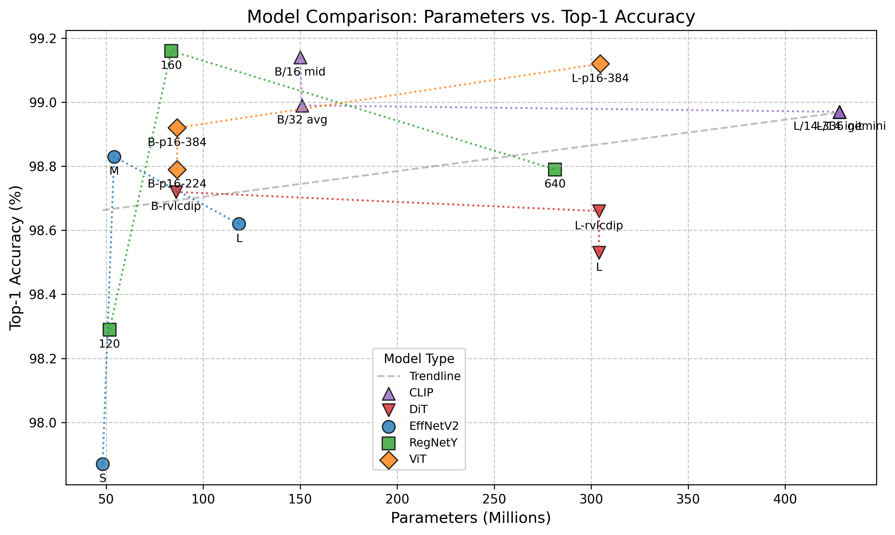

# The base-model sweep of 2025 (`vX.3`)

For anyone who wonders why these five base models: the 2025 sweep that compared twelve base models and chose the five
of the ensemble, kept as evidence of that choice. Its figures are **not held-out accuracy**; the held-out results of
the published models are in [results.md](results.md).

> ⚠️ These figures were measured on the 5,449-page evaluation set, most of whose pages are training pages. The script
> that selected it as "pages no fold trained on" (`result/stats/unused.sh`, fixed since `v1.9.6-beta`) missed
> zero-padded page numbers and ids with a letter
> ([atrium-project#15](https://github.com/ufal/atrium-project/issues/15)). The figures chose each base model's fold
> ([how](../../result/README.md#how-the-folds-were-chosen)), and they are not held-out accuracy. The stored tables do
> not all reproduce them either: `v4.3` gives 98.92 % there, not 99.16 %.

| Base model                                 | Revision | Best_Prec (%) | Best_Acc (%) | Fold | Note                  |
|--------------------------------------------|----------|---------------|--------------|------|-----------------------|
| **google/vit-base-patch16-224**            | **v2.3** | **98.79**     | **98.79**    | 5    | OK & Small            |
| **google/vit-base-patch16-384**            | **v3.3** | **98.92**     | **98.92**    | 2    | Good & Small          |
| **google/vit-large-patch16-384**           | **v5.3** | **99.12**     | **99.12**    | 2    | Best & Large          |
| microsoft/dit-base-finetuned-rvlcdip       | v9.3     | 98.71         | 98.72        | 3    |                       |
| microsoft/dit-large-finetuned-rvlcdip      | v10.3    | 98.66         | 98.66        | 3    |                       |
| microsoft/dit-large                        | v11.3    | 98.53         | 98.53        | 2    |                       |
| timm/regnety_120.sw_in12k_ft_in1k          | v12.3    | 98.29         | 98.29        | 3    |                       |
| **timm/regnety_160.swag_ft_in1k**          | **v4.3** | **99.17**     | **99.16**    | 1    | Best & Small (`main`) |
| timm/regnety_640.seer                      | v6.3     | 98.79         | 98.79        | 5    | OK & Large            |
| timm/tf_efficientnetv2_l.in21k_ft_in1k     | v8.3     | 98.62         | 98.62        | 5    |                       |
| **timm/tf_efficientnetv2_m.in21k_ft_in1k** | **v1.3** | **98.83**     | **98.83**    | 1    | Good & Small          |
| timm/tf_efficientnetv2_s.in21k             | v7.3     | 97.90         | 97.87        | 1    |                       |

The rows in bold are the five models uploaded to the Hugging Face Hub, and their revisions are the published ones,
adjusted for the Hub (which explains the odd order of the base models). The labels of the other rows follow neither
the published numbering nor the sweep's own numbering in [model_accuracies_new.csv](../../model_accuracies_new.csv)
and `REVISION_TO_BASE_MODEL`, which has, for example, RegNetY-120 as `v6.` and EfficientNetV2-S as `v1.3.1`; the base
model names identify the rows ([the two namespaces](../reference/models.md#two-version-namespaces-and-where-they-collide)).

The table and the figure compare the base models by these sweep figures and by their parameter counts. The sweep's
candidates were the five chosen models and the DiT family, RegNetY-120 and -640, and EfficientNetV2-S and -L.

## How the five were chosen

The sweep trained every base model on five folds and kept, per base model, the fold with the highest top-1 on the
5,449-page set; a tie went to the lowest fold. These are the folds of `REVISION_BEST_FOLDS`, and the `vX.4` models were
retrained on them; the `vX.4` test partitions played no part in any choice. The figures per fold, the 5,449-page set
split by group, and what was wrong with the earlier results: [result/README.md](../../result/README.md).
