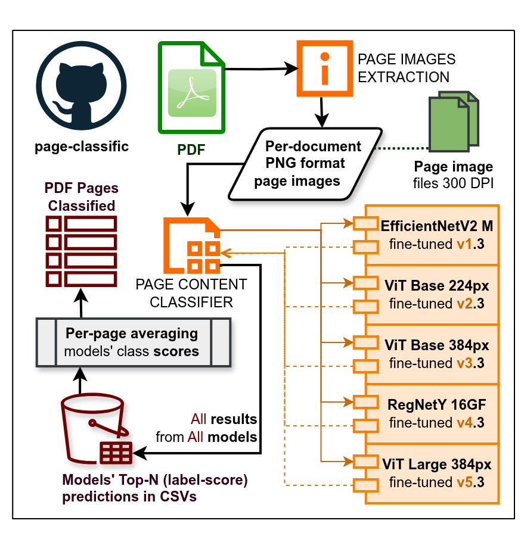
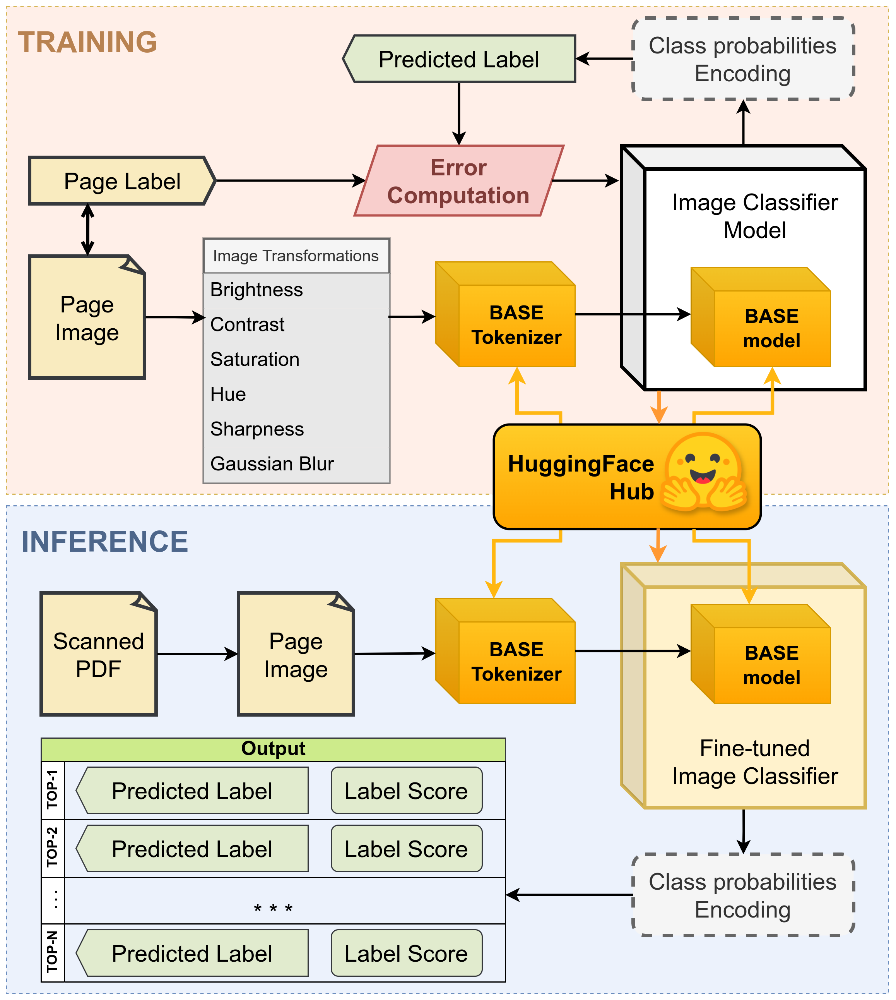

# How page-classification works

For anyone who wants the idea before the details: what the classifier is for, how one page gets its category, how
the five-model ensemble combines its members, and how `--best` fits the models into GPU memory. The flags are in
[reference/cli.md](reference/cli.md); the models in [reference/models.md](reference/models.md).

On this page:
[What it is for](#what-it-is-for) ·
[The models](#the-models) ·
[How a prediction is made](#how-a-prediction-is-made) ·
[One model or five](#one-model-or-five) ·
[From a document to its pages](#from-a-document-to-its-pages) ·
[The memory-aware `--best` engine](#the-memory-aware---best-engine) ·
[What it takes in and hands on](#what-it-takes-in-and-hands-on)

## What it is for

The models were trained on a manually annotated dataset of historical documents: images of pages of archival
documents with paper sources that were scanned into digital form. The pages hold various combinations of text,
tables, drawings and photos, and the [eleven categories](reference/categories.md) were formed from those documents.
Examples are in [small_data_samples](../small_data_samples).

The key use case is to classify a page image, taken from a scanned PDF, into one of the categories, each of which
leads to its own content-specific processing. In other words, when several services for different OCR tasks are at
your disposal, run this classifier first to mark each page as machine-typed (old-style fonts), handwritten or printed
text, plain or in a table, and to mark the presence of printed or drawn graphics to be extracted from the page.

It is an image classifier: a fine-tuned vision model looks at the whole page at once and returns a probability for
each category. No text is read, so the language of the page does not matter.

The inference method, with the five models of the ensemble:



## The models



The fine-tuned models are in UFAL's [vit-historical-page](https://huggingface.co/ufal/vit-historical-page)
repository, one revision per model. Their bases are Google's ViT-B/16 at 224 and 384 pixels and ViT-L/16 at 384
pixels, and timm's RegNetY-16GF (`regnety_160.swag_ft_in1k`) and EfficientNetV2-M
(`tf_efficientnetv2_m.in21k_ft_in1k`). All of them run in the same three ways: the batch command line (`run.py`),
the HTTP service (`POST /predict_image`, `POST /predict_document`), and an Agent Skill that wraps the service. The
revisions, their generations and sizes: [reference/models.md](reference/models.md).

Two alternatives sit beside the main line: an Ultralytics YOLO classification backend (`--yolo`), and a CLIP-based
classifier on the `clip` branch ([models](reference/models.md#alternatives-beside-the-main-line)).

## How a prediction is made

1. **Load and resize.** Each page image is resized to the model's square input, 224 or 384 pixels depending on the
   base model, and normalised with that base model's own mean and standard deviation. Nothing is cropped or rotated:
   the orientation and the margins of a page are part of what the model sees. A PDF's pages are first rendered at
   300 dpi (`PDF_RENDER_DPI`), by the same renderer on the command line and in the service.
2. **Score.** The model produces one value per category; a softmax turns them into probabilities that sum to 1.
3. **Rank.** The `N` highest (`-tn`, 3 by default) become `CLASS-1…N` and `SCORE-1…N`, best first. The scores are
   renormalised over the best max(N, 2) categories, so `SCORE-1` is the model's confidence in its top answer
   relative to its nearest alternatives.

The image transforms are made from the base model, which is why a revision always builds on the base the registry
lists for it ([models](reference/models.md#how-a-revision-is-named)).

## One model or five

By default one model runs: the revision chosen with `-rev`, or a local checkpoint. `--best`, and the service's
`version=all`, run the five models of the ensemble (`v1.4`–`v5.4`) on every page and average their scores:

- Each model gives its own Top-N categories, its scores renormalised over its N best. The scores are summed per
  category and divided by the number of models that answered, and the result is ranked again: one function on the
  command line (`ensemble.average_rdfs`) and its counterpart in the service (`average_prediction_dicts`), alike since
  `v1.11.0-beta`. Since `v1.12.0-beta` the command line averages the scores as the models gave them and rounds only
  its table: it averaged scores already rounded to three decimals, so a table could read `0.48200000000000004`, and
  a category whose rounded scores were all 0 fell out of a top-11.
- The command line also records each model's own top-1 vote, so disagreement stays visible; the service returns each
  model's own top-N with `per_model=true`. A model that fails is left out of the average on both sides (on the
  command line since `v1.12.0-beta`; it stopped the run): the command line names the models that answered, the
  service lists them in `models_used`.

The averaging is a mean of probabilities, not a majority vote: confident models weigh more than uncertain ones. It
usually raises overall accuracy, but it can lower it for the most ambiguous pairs, such as `TEXT` and `TEXT_T`, whose
pages often look alike. The ensemble has no held-out accuracy of its own, because its members were trained on
different folds ([evaluation/results.md](evaluation/results.md)).

`--average` is a different thing: it averages the **weights** of several fold checkpoints of one base model into a
single model, before any page is seen ([training.md](training.md#averaging-fold-models)).

**Where the command line and the service still differ** (kept as they are since the service–CLI alignment of
v1.10.0-beta, atrium-project#72, and pinned by `tests/test_cli_service_parity.py`):

- **Rounding.** The command line's tables round scores to three decimals; the service's answer does not. The
  record's `category_confidence` has three decimals from both (since `v1.12.0-beta`; the service's was unrounded).
- **The default model.** The command line runs the model of `[HF] revision` in `setup/config.txt` (`main`), the batch
  image's default command `v4.3`; the service runs the ensemble (`version=all`). Name the model (`-rev`, `version`) to
  compare the two.

Everything else is the same on both sides:
- the ensemble is averaged as described above;
- a transparent image is put on a white background before the model sees it (`page_inputs.flatten_on_white`; until
  `v1.11.0-beta` the service kept the colour stored under a transparent pixel, often black);
- a PDF is rendered by one renderer at `PDF_RENDER_DPI`, and a `pages` selection means the same pages;
- the doc_id and the page keys are derived by the same functions, and a born-digital record's page labels are honoured
  by both.

## From a document to its pages

A document is classified page by page: a PDF is rendered into page images by one renderer
(`service/pdf_render.py`), on the command line (`-f report.pdf`, or `-d` with `-ff …,pdf`) and in the service alike,
and each page gets its own category. The [data-preparation scripts](data-preparation.md#pdf-to-png) remain for
splitting a collection ahead of a run. A page image's file name carries the document and the page number
([usage.md](usage.md#name-the-page-images)).


## The memory-aware `--best` engine

The `--best` ensemble is implemented in [parallel_best.py](../parallel_best.py). By default it runs **sequentially**,
one model at a time with a full pass over the data each: the guaranteed-safe path, and what `--best` alone does. The
optional `--parallel` flag turns on a **memory-aware grouped engine** on CUDA.

> [!NOTE]
> **What `--parallel` does and does not buy you on a single GPU.** A single GPU serialises kernels across the
> models it holds, so holding several models in VRAM does **not** reduce GPU math time. The gain is turning *five
> passes over the data* (one per model, decoding every page five times) into **one pass** that loads all the models
> that fit and streams the inputs once, which removes repeated disk decoding and loading and unloading. How much that
> gains depends on the ratio of I/O to compute and should be measured, not assumed. **The real speed-up is multi-GPU**
> (one model or group per device), planned as a follow-up.

How the parallel engine schedules the work:

1. **Profile.** On first use it measures each model's peak VRAM over the first two batches and records it in
   `model/gpu_profile.json`.
2. **Pack.** The models are grouped greedily (first-fit decreasing) so that each group's summed peak fits the **live
   free VRAM** at run time (90 % of what is free, minus a 512 MB margin). On a small GPU this falls back to groups
   of one, which is the sequential path and still safe.
3. **Run.** Each group is loaded together, and the inputs are streamed once through every model in it.
4. **Guard.** After the first two batches, if the live peak memory approaches capacity, the largest model is dropped
   from the group and deferred to the sequential fallback.

`--parallel` **falls back to the sequential path** (no change in behaviour) whenever it is not safe: on CPU or MPS
(no CUDA memory functions), when the data set is too small to profile, when the saved profile is stale and
re-profiling fails, or when the overflow guard cannot keep a group within budget. Its output files are identical to
a sequential run's.

### The GPU profile and the static model catalogue

The engine keeps **measured, machine-specific** facts apart from **intrinsic, hardware-independent** ones:

* **`model/gpu_profile.json`** is dynamic. It records the GPU (`name`, `total_vram_bytes`, the `torch` version), the
  `batch` it was measured at, and each model's `peak_bytes`. It is treated as stale, and measured again, when the GPU,
  the torch version or the batch size changes, or when it does not cover every model needed. `peak_bytes` is the
  **only** input to the packing.
* **`MODEL_STATIC`** (in [model_registry.py](../model_registry.py)) is static and committed: each model's
  `params_bytes` (the fp32 weight size), `resolution` and `base_model`. These do not depend on the GPU, the torch
  version or the batch, so they are not stored in the profile. They are used to (a) sanity-check measured peaks
  (`peak_bytes` must exceed `params_bytes`), (b) bootstrap the packing before any peak has been measured, and (c)
  weight a future multi-GPU split.

An example profile:

```json
{
  "gpu":   { "name": "NVIDIA A30", "total_vram_bytes": 25229983744, "torch": "2.7.1+cu126" },
  "batch": 16,
  "models": {
    "v4.3": { "base_model": "timm/regnety_160.swag_ft_in1k", "resolution": 384, "peak_bytes": 2098562560 },
    "v5.3": { "base_model": "google/vit-large-patch16-384",  "resolution": 384, "peak_bytes": 2771266560 }
  }
}
```

On a free 24 GB card the five models (a summed peak of about 7.9 GB) pack into a **single group**: one pass over the
data for all of them.

> [!WARNING]
> `params_bytes` is **not** a reliable proxy for the peak: the ratio of peak to parameters across the five models
> ranges from about 2.3× (ViT-L, weight-heavy) to about 6.5× (RegNetY at 384 px, activation-heavy). Without a
> measurement the engine therefore over-estimates from `params_bytes`, which tends to put a model in a group of its
> own, so that it can never under-provision and run out of memory.

The flags that change `--best` (`--parallel`, `--save-intermediates`, `--no-average-best`):
[reference/cli.md](reference/cli.md#ensemble).

## What it takes in and hands on

|                         |                                                                                                                                                  |
|-------------------------|--------------------------------------------------------------------------------------------------------------------------------------------------|
| **In**                  | a page image (PNG or JPEG), or, through the service, a PDF: up to 50 pages (`MAX_PDF_PAGES`) and 10 MB (`MAX_UPLOAD_MB`) by default              |
| **Out**                 | a Top-N CSV (`FILE, PAGE, CLASS-1…N, SCORE-1…N`), optionally a per-category raw CSV, a paradata JSON, and, when asked, an ATRIUM document record |
| **Owns in the record**  | the whole `page_categories` block, and `pages[].category` and `pages[].category_confidence`                                                      |
| **Reads from upstream** | nothing: it is the first stage, and its input is the scan itself                                                                                 |

page-classification's categories **inform a routing decision** rather than trigger one: which pages go to OCR,
which to handwriting recognition, which to table extraction, which to image extraction. A person or a script reading
the result tables makes that decision. The next stage, ocr-postprocess, works from OCR output and does not read
`page_categories`.

What travels between the stages is the **record**. Each stage takes `--document-json` in, writes only the block it
owns, deep-copies everything else, and stamps `assembled.blocks[<block>]` with its `program`, `run_id` and
`paradata_ref`. `BLOCK_OWNERS` in the hub's canonical `atrium_document.py` says which program **may** write a block;
`assembled.blocks[<block>].program` in a given record says which program **did**. The file flow and the record flow,
side by side: the hub's [Pipelines](https://ufal.github.io/atrium-project/pipelines/) page.
